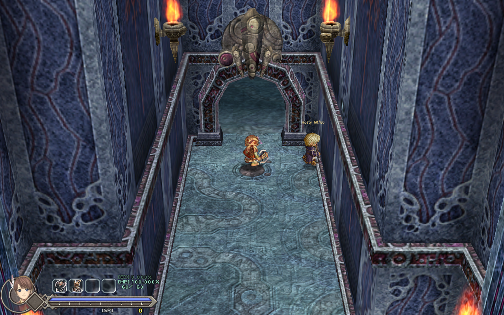

# Co-op

Play **Ys Origin** with friends on CleriaCore: one player hosts, the others join.

**Version 0.1: a first playable step, not the finished thing.** It needs a CleriaCore with **mod API 7**, which is
not in a released build yet (branch `feat/mod-api-7`).

| | |
|---|---|
| **You see each other** | In the same room each player is drawn with their own character, moving, jumping and attacking as on their own screen, their name and HP over them |
| **Shared monsters** | A room's monsters are the same for everybody in it: one player's game runs them (the first one in the room), the others show them and send their hits |
| **Shared EXP and SP** | A kill in your room gives you its EXP and SP too |
| **Friendly fire** (off) | Your hits hurt the others and theirs hurt you, priced against the victim's own defence |
| **Shared items** (off) | An item one player obtains is given to the others: skills, keys, gear |

Each rule is each player's own switch (F1 > Mods > Co-op, or **F6** in game); friendly fire needs both players to
turn it on.

## Playing

1. Everybody installs the mod and turns it on (F1 > Mods), then restarts CleriaCore.
2. The host opens the Co-op window (**F6**) and picks **Host a game**. Windows asks once to let the game through the
   firewall. Over the internet, forward the port (7777, TCP) to the host's machine, or use a VPN that puts you on
   one network.
3. The others type the host's address and pick **Join a game**.

Everybody plays their own game and their own save: pick the same character or different ones, walk to the same
room, and you are together. Rooms you are not sharing are your own.

## What it does not do yet

- **Monsters only attack the player whose game runs them.** On the other screens they move and animate, but their
  hits do not reach those players. This is the big one.
- **Bosses, room scripts, chests, doors and drops are each player's own.** A boss fought together is two fights
  side by side: the engine's boss modules have no state a mod can copy.
- Skill effects and Toal's trail are not drawn on the other players; a monster's death is a disappearance on the
  screens that do not run it.
- No lobby, no reconnection, no encryption: play with people you know.

## How it works

One TCP connection per guest, to the host; every message is a line of JSON and the host passes the guests'
messages on, so only the host has to be reachable. Twenty times a second each player sends their room and pose
(`cleria.player.pose`), drawn elsewhere as a puppet (`cleria.world.puppet`). Ten times a second the owner of a
room (the lowest player number in it) sends its monsters (`cleria.world.snapshot`); the others hold theirs and
apply it (`cleria.world.apply`). A hit on a monster you do not own is sent to its owner, who lands it
(`cleria.combat.damage`); a swing that lands on a player's puppet is sent to that player, whose game prices it
(`cleria.combat.strike`).

## Tests

`.dev/duo.py` starts **two games** on one machine, one hosting and one joining over the loopback, each driven by
its own script, and checks both outputs:

- `together`: they meet, each has the other's puppet, the guest's 11 monsters are held and follow the host's, a hit
  of the guest's lowers the host's monster (86 to 81 HP on both screens), the host's kill gives the guest its EXP
  and SP and both end with 10 monsters.
- `friendly_fire`: with the rule on both sides, the host's swing on the guest's puppet hurts the guest.
- `apart`: in different rooms nobody is drawn and each player owns their room.

Not tested: more than two players, two machines on a real network, a long session.

## About

By 4rtefakt, written with Claude (Anthropic). MIT licence. Not affiliated with Nihon Falcom or XSEED.
