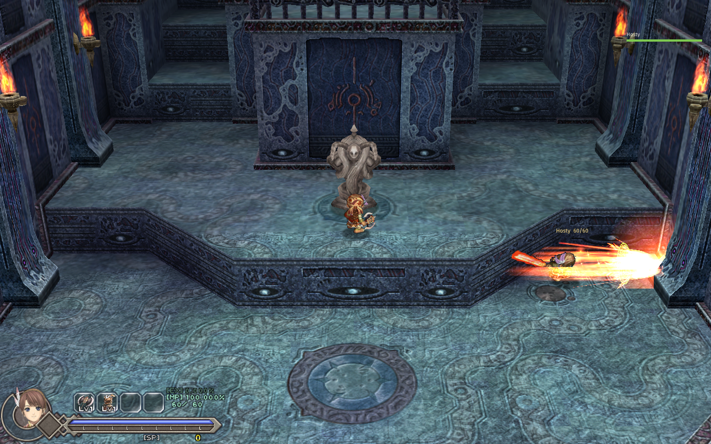

# Co-op

Play **Ys Origin** with friends on CleriaCore: one player hosts, the others join.

It needs a CleriaCore with **mod API 7**, which is not in a released build yet (branch `feat/mod-api-7`).

| | |
|---|---|
| **You see each other** | In the same room each player is drawn with their own character, moving, jumping and attacking as on their own screen, their name and HP over them. A party list shows everybody's HP and room |
| **Shared monsters** | A room's monsters are the same for everybody in it. They chase the nearest player and hit whoever they reach |
| **Shared bosses** | Each player fights the boss on their own screen, but the gauges fall together, and when one player wins, the others' boss falls at their next hit |
| **Shared EXP and SP** | A kill in your room gives you its EXP and SP too |
| **Revive** | A hit that would kill you while a teammate stands in the room puts you down for 10 seconds instead, 3 times faster with a teammate beside you. If nobody is left standing, the fall is real |
| **Tougher monsters** | 60 % more HP for each player beyond the first |
| **Go to a player** | One button takes you to the room a teammate is in |
| **Chat** | A line of text, shown to everybody |
| **Shared progress** (off) | Items one player obtains are given to the others (skills, keys, gear); chests, locked doors and bosses one player dealt with are done for the others |
| **Friendly fire** (off) | Your hits hurt the others and theirs hurt you, priced against the victim's own defence |

Each rule is each player's own switch (F1 > Mods > Co-op, or **F6** in game). Friendly fire needs both players to
turn it on; the rest is best set the same by everybody.

## Playing

1. Everybody installs the mod and turns it on (F1 > Mods), then restarts CleriaCore.
2. The host opens the Co-op window (**F6**) and picks **Host a game**. Windows asks once to let the game through the
   firewall. Over the internet, forward the port (7777, TCP) to the host's machine, or use a VPN that puts you on
   one network.
3. The others type the host's address and pick **Join a game**. A guest who loses the connection keeps trying.

Everybody plays their own game and their own save: pick the same character or different ones, walk to the same
room (or use *Go to ...*), and you are together. Rooms you are not sharing are your own.

## How the sharing works, and its edges

- **One player's game runs a room's monsters**: the first one who was in it (the lowest player number). The others'
  copies are held and shown from that game, ten times a second. A hit on a monster you do not run is sent to the
  player who does; it shows on your screen at once but the kill is theirs to confirm. Their monsters see every
  player; a hit that lands on you on their screen is sent to you and priced by your own game (your DEF, your
  i-frames). With lag you can be hit by a swing you saw miss.
- **Bosses are not shared as one fight.** The engine's boss modules cannot be copied between machines, so each
  player has their own boss with its own moves. What is shared is its health: the player whose gauge is fuller has
  the difference added to their next hits. Stand back and never hit, and your boss does not go down.
- **Room scripts, chests, doors, switches and drops are each player's own.** *Shared progress* copies the outcome
  (the item, the opened chest, the unlocked door, the beaten boss) to the others' saves; it does not replay the
  scene. A door a teammate unlocked is open for you the next time you enter the room.
- A teammate's skills and swings show their effects, but not sword trails, Hugo's shots and eyes, or the charge
  glow; a monster killed by another player just disappears from your screen.
- No lobby, no password, no encryption: play with people you know.

## How it works

One TCP connection per guest, to the host; every message is a line of JSON and the host passes the guests'
messages on, so only the host has to be reachable. Twenty times a second each player sends their room and pose
(`cleria.player.pose`), drawn elsewhere as a puppet (`cleria.world.puppet`) and glided between two poses. Ten times a
second the owner of a room sends its monsters (`cleria.world.snapshot`); the others hold theirs and apply it
(`cleria.world.apply`). The owner's puppets are *targets* (`set_puppet{target = true}`): its monsters chase them and
a hit on one raises `puppet_struck`, sent on and landed by `cleria.combat.strike`. A hit on a monster you do not
own goes to its owner (`cleria.combat.damage`). Bosses use `cleria.world.boss` and `cleria.combat.boss_bonus`; skill
effects are the `player_effect` event replayed by `cleria.world.puppet_effect`.

## Tests

`.dev/duo.py` starts **two games** on one machine, one hosting and one joining over the loopback, each driven by
its own script, and checks both outputs:

| case | what it shows |
|---|---|
| `together` | They meet, each has the other's puppet, the guest's 11 monsters are held and follow the host's, a hit of the guest's lowers the host's monster on both screens, the host's kill gives the guest its EXP and SP |
| `struck_and_revive` | The host's monsters wake for the guest who walks up to them and hit her; she goes down instead of dying and gets back up |
| `fall_alone` | Alone in a room, the same fall is a death |
| `boss` | Two Velagunders; only the host hits his; the guest's pool fills, the host's win is announced, and the guest's next hits end her fight |
| `chat_and_follow` | A line of chat arrives; *follow* takes the guest to the host's room, where they see each other |
| `retry` | A guest who starts before the host keeps trying and gets in |
| `effects` | The host casts his fire skill; the guest's game shows its flames on his puppet (the picture above) |
| `progress` | With shared progress on both sides, an item the host obtains and a door flag he sets arrive in the guest's game |
| `tougher` | A room entered with two players connected is built with 1.6 times the HP (86 to 137), on both screens |
| `friendly_fire` | With the rule on both sides, the host's swing on the guest's puppet hurts the guest |
| `apart` | In different rooms nobody is drawn and each player owns their room |

Not tested: more than two players, two machines on a real network, a long session, a real chest or boss flag
through shared progress (the cases send an item and a door flag by command).

## About

By 4rtefakt, written with Claude (Anthropic). MIT licence. Not affiliated with Nihon Falcom or XSEED.
